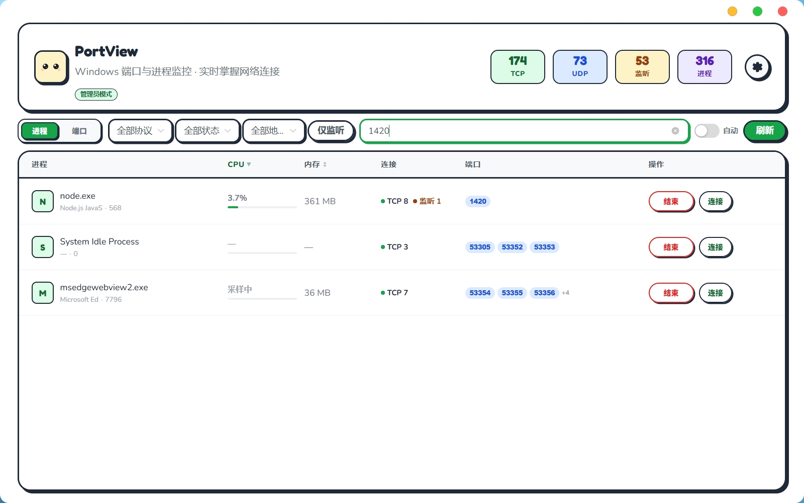
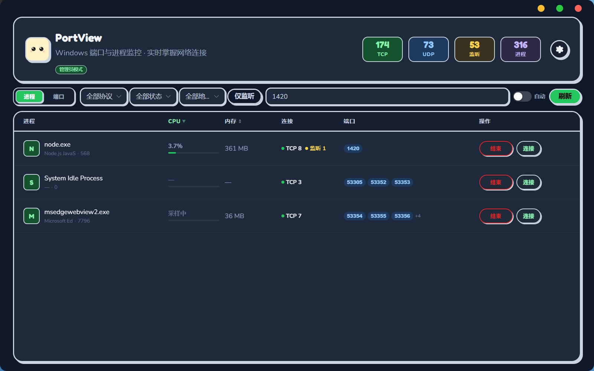
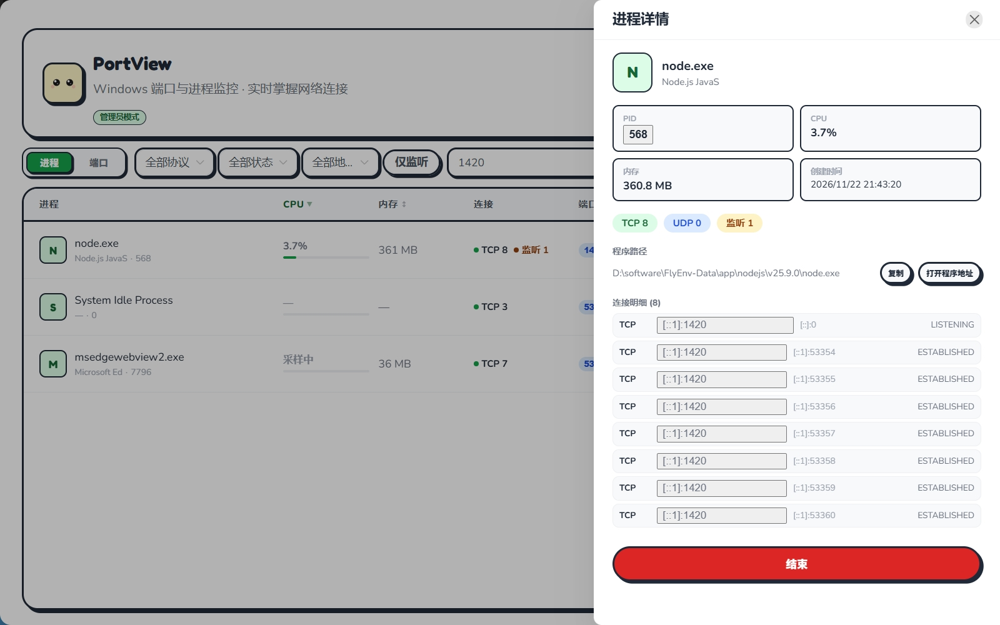
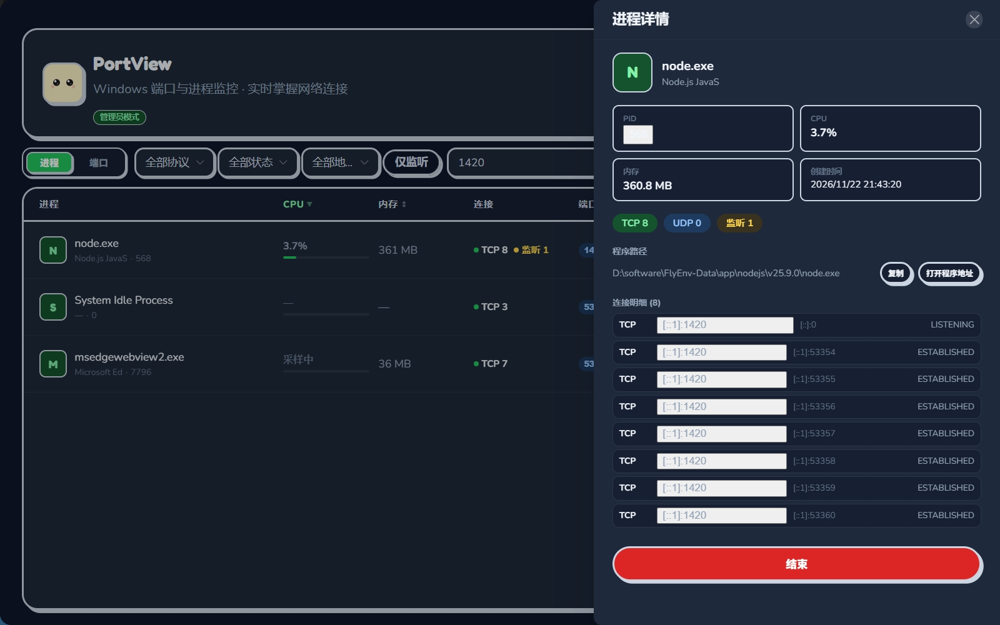
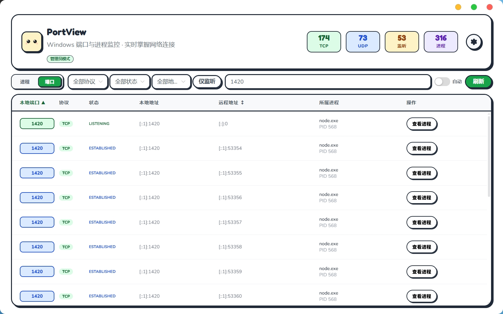
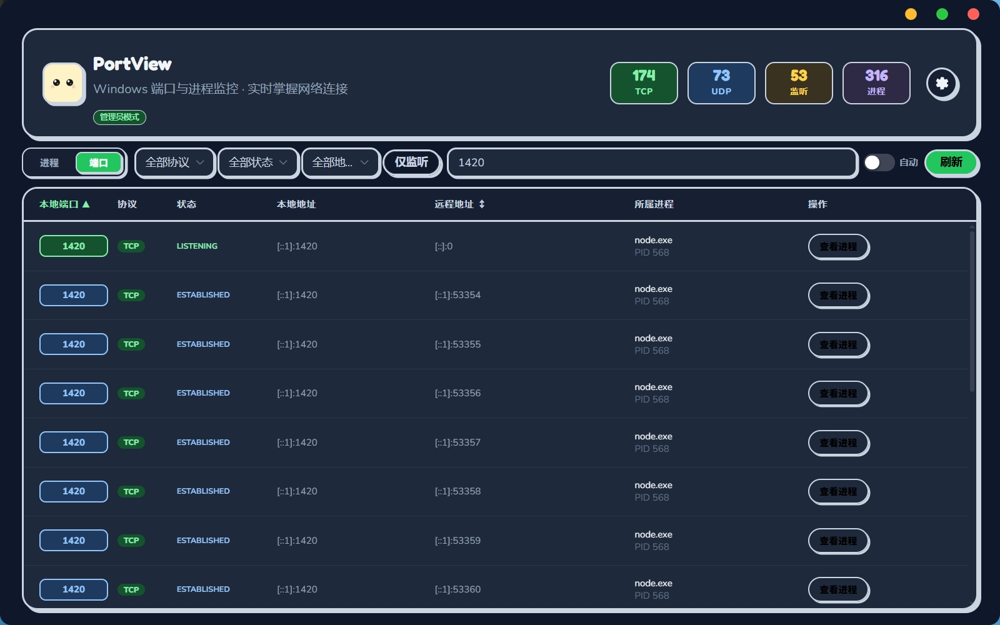

<h1 align="center">PortView</h1>

<p align="center"><em>See what owns every port — in one calm, sticker-style window.</em></p>

<p align="center">
  <a href="./README.zh-CN.md">中文</a> · <strong>English</strong>
</p>

<p align="center">
  <a href="LICENSE"></a>
  <a href="https://gitee.com/ShiXiongZhiDao/PortView/releases"></a>
  <a href="./README.zh-CN.md"></a>
  <a href="#privacy"></a>
  <a href="https://gitee.com/ShiXiongZhiDao/PortView/releases"></a>
</p>

<p align="center">
  
</p>

## Download

Tested on Windows 10 / 11 x64; other platforms can be built from source. Open a channel link below to download from its release page:

| Form | File | Notes | Channel |
|---|---|---|---|
| Installer | `PortView_<version>_x64-setup.exe` | Installs for the current user, no admin rights needed to install; supports in-app updates | [Gitee](https://gitee.com/ShiXiongZhiDao/PortView/releases) · [GitHub](https://github.com/ShiXiongZhiDao/PortView/releases) |
| Portable | `PortView_<version>_x64-portable.zip` | Unzip and run; new versions need a manual download | [Gitee](https://gitee.com/ShiXiongZhiDao/PortView/releases) · [GitHub](https://github.com/ShiXiongZhiDao/PortView/releases) |

Prefer compiling it yourself? See [Build from source](#build-from-source). PortView starts in **limited mode** without a UAC prompt. Elevate from the title bar or Settings when you need full data. See [Why administrator?](#why-administrator).

## What it is

PortView is a small local Windows tool that answers two questions: **which process owns a port, and how much CPU and memory is it using?** Everything stays on your computer.

## Core features

- **Two views** — processes or ports, switch with one click at the top.
- **Fast search & filters** — search by name, PID, port or pinyin, and filter by protocol or state.
- **Metrics at a glance** — CPU, memory, connections and paths; `—` means unreadable, never a fake zero.
- **Auto + manual refresh** — updates every 3 seconds by default, or refresh any time yourself.
- **Safer termination** — checks process identity before ending it, so you don't kill the wrong one.
- **Small touches** — click to copy, resizable columns, light/dark themes and Chinese/English UI.

## Screenshots

| View | Light | Dark |
|:---:|:---:|:---:|
| Processes |  |  |
| Process detail |  |  |
| Ports |  |  |

## Quick start

1. Install from the Releases page on [Gitee](https://gitee.com/ShiXiongZhiDao/PortView/releases) or [GitHub](https://github.com/ShiXiongZhiDao/PortView/releases) and launch it. It opens in **limited mode** without UAC. Click **Limited mode · Elevate** in the title bar when you need full access.
2. Use the top tabs to switch between **Process** and **Port**. Type in the search box to match names, PIDs, ports or pinyin; use the dropdowns for protocol, state and address family.
3. In the process view, click **CPU** or **Memory** to sort, expand a row for its connections, or double-click the row to open the detail drawer.
4. In the port view, click a port, address or PID to copy it; double-click a row to jump to the process view.
5. To end a process, right-click its row (or use the button in the detail drawer) and confirm. `Ctrl+F` focuses search, `F5` takes a fresh snapshot.

## Scope and limits

- Tested on Windows 10 / 11 x64; other platforms can be built from source. The WebView2 Runtime is required (preinstalled on Windows 11).
- Runs locally. It never scans or manages remote machines, and the port view is read-only.
- Starts in **limited mode** by default, with no UAC prompt. Protected process paths, metrics, and some endpoint owners may be unavailable. Click the **Limited mode** badge in the title bar or use **Settings → Restart as administrator** to elevate.
- CPU / memory may be `—`, "Sampling" or "No access" for processes that exit or deny access. This is a real "unknown", not zero.
- Timed refresh does **not** pause when the window is hidden or loses focus. Turn the switch off for manual-only refresh.
- Only the target process is terminated; there is no process-tree termination.
- One refresh is one snapshot, not a live stream. Connection state can change between snapshots.

### Why administrator?

Windows hides protected processes' image paths and metrics from non-elevated callers, and limits access to some TCP/UDP owner tables and to process termination. Elevating lets PortView read full paths, enumerate all endpoint owners, and terminate a process only after checking its identity. The title bar badge always shows the actual permission level.

## Privacy

Anonymous usage statistics record only app launches and the theme and language in use at launch; no process, port or address data is uploaded.

## FAQ

**Is the `.exe` really the same program as the source?**
Yes. The installer and the source build come from this repository; the release page carries the signed installers.

**Why would I elevate to administrator?**
Windows hides the image path and metrics of protected processes, and denies access to some TCP/UDP owner tables, for non-elevated callers. Elevating lets PortView read them and terminate a process only after checking its identity.

**Why do I see `—`, "Sampling" or "No access"?**
That process exited between snapshots or denied the query. PortView shows the real state instead of pretending the value is zero.

**Does timed refresh stop when the window is hidden?**
No. There is no hidden/focus-based pause. If you want manual-only refresh, switch it off in the top bar.

**Can I end a process from an old snapshot?**
Only if its identity still matches. PortView re-opens the process, compares PID + creation time, and refuses if the process was replaced. Refresh and try again if you see that message.

**Why is a port shown with no process name?**
Some system endpoints cannot be mapped to an owning PID without elevation, or the owner exited before the query. Elevate and refresh, or run as administrator.

## Build from source

Requirements: [Node.js](https://nodejs.org/) with **pnpm**, a stable Rust toolchain (MSVC), and WebView2 Runtime.

```bash
# 1. Install frontend dependencies
pnpm install

# 2a. Frontend only — no native IPC, so lists stay empty
pnpm dev

# 2b. Full desktop app — starts in limited mode
pnpm tauri dev
```

The dev app also starts in limited mode. Test the elevation flow with an installed build: `pnpm tauri dev` owns the frontend dev server, so a relaunched elevated instance may not have a server to load from.

```bash
pnpm tauri build
```

The NSIS installer is written under `target/release/bundle/nsis/` as `PortView_<version>_x64-setup.exe`. The installed app, its folder, shortcuts, tray icon and uninstaller are all named PortView.

## License and credits

PortView is open source under the [MIT License](LICENSE) — use, modify and redistribute it, including commercially, as long as the copyright notice is kept.

Built with Tauri 2, Vue 3, TypeScript, Vite, UnoCSS, Pinia, naive-ui and `pinyin-pro`; native data comes from Windows APIs via the `windows` crate. Fonts are Fredoka and Nunito.

## Support the author

If this tool saved you a few minutes, you can buy the author a coffee. QR codes load from a public image repository and are not bundled with the installer:

<table>
  <tr>
    <th align="center">Alipay</th>
    <th align="center">WeChat Pay</th>
  </tr>
  <tr>
    <td align="center">
      
    </td>
    <td align="center">
      
    </td>
  </tr>
</table>

## Contact

- Author: 师兄知道 (ShiXiongZhiDao)
- Website: [shixiongzhidao.cn](https://shixiongzhidao.cn)
- WeChat Official Account: 师兄知道
- Repository and issues: [Gitee](https://gitee.com/ShiXiongZhiDao/PortView)

Scan to follow 师兄知道 on WeChat:


