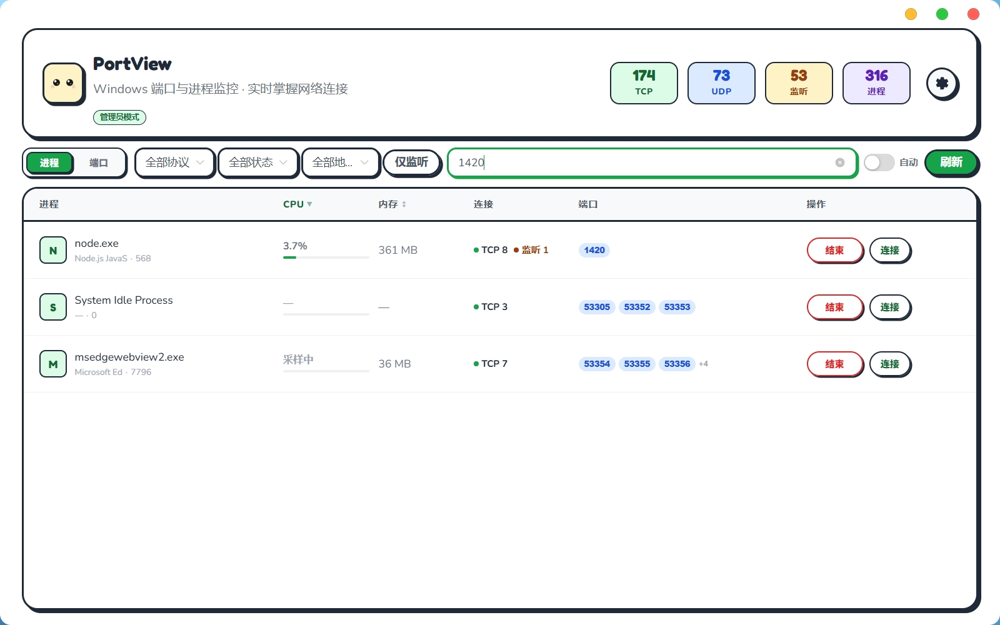
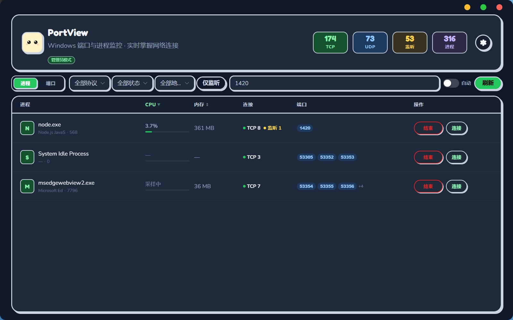
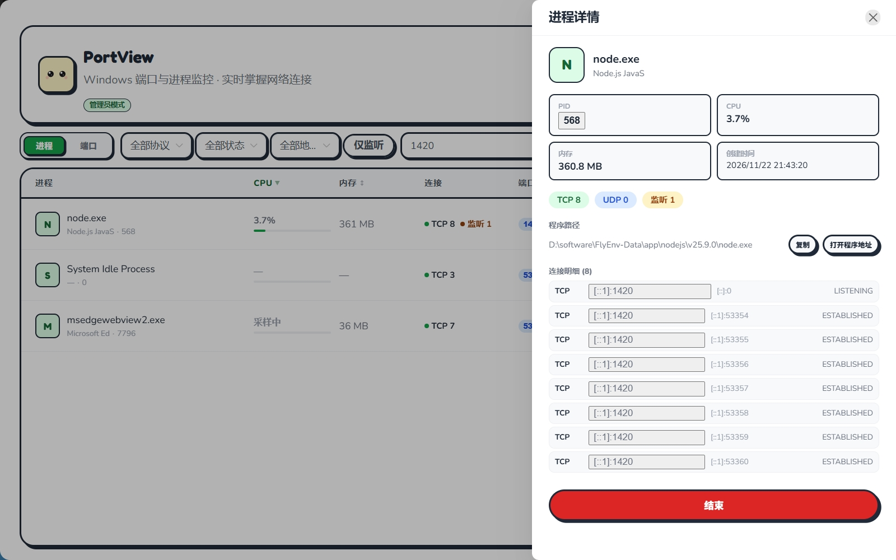
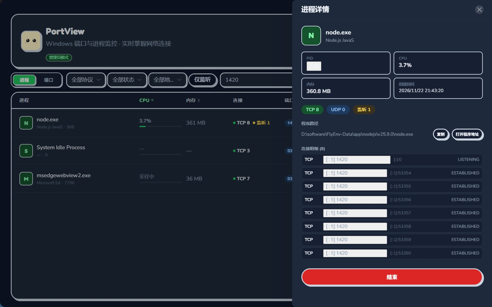
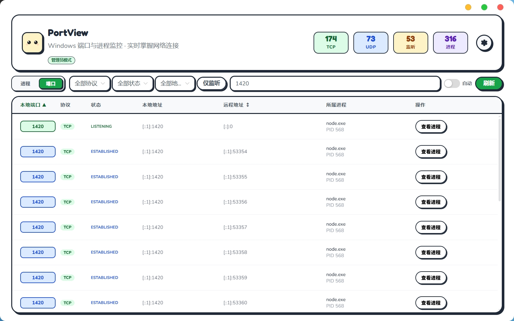
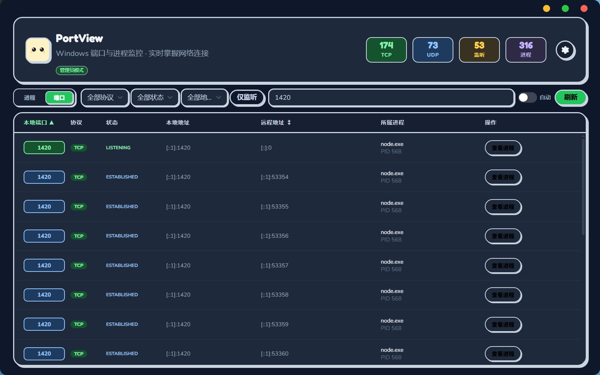

<h1 align="center">PortView</h1>

<p align="center"><em>一个窗口看清：哪个进程占用了端口，它又用了多少资源。</em></p>

<p align="center">
  [English](./README.md) · 中文
</p>

<p align="center">
  [](LICENSE)
  [](https://gitee.com/ShiXiongZhiDao/PortView/releases)
  [](./README.md)
  [](#隐私)
  [](https://gitee.com/ShiXiongZhiDao/PortView/releases)
</p>

<p align="center">
  
</p>

## 下载

自测支持 Windows 10 / 11 x64，其他平台可自行构建。点渠道链接进入发布页下载：

| 形态 | 文件 | 说明 | 渠道 |
|---|---|---|---|
| 安装版 | `PortView_<版本号>_x64-setup.exe` | 按当前用户安装，安装无需管理员权限；支持应用内更新 | [Gitee](https://gitee.com/ShiXiongZhiDao/PortView/releases) · [GitHub](https://github.com/ShiXiongZhiDao/PortView/releases) |
| 便携版 | `PortView_<版本号>_x64-portable.zip` | 解压即用；新版本需手动下载 | [Gitee](https://gitee.com/ShiXiongZhiDao/PortView/releases) · [GitHub](https://github.com/ShiXiongZhiDao/PortView/releases) |

想自己编译，见[从源码构建](#从源码构建)。默认以**受限模式**启动，不弹 UAC；需要完整数据时，在标题栏或设置页主动提升为管理员。见[为什么需要管理员](#为什么需要管理员)。

## 它是什么

PortView 是个本地 Windows 小工具，帮你看清两件事：**哪个进程占用了端口，它用了多少 CPU 和内存。** 数据只留在本机，不上传。

## 核心特点

- **进程 / 端口双视图**：按进程或按端口看，顶部一键切换。
- **搜索筛选快**：名称、PID、端口、拼音都能搜，还能按协议和状态筛。
- **资源一目了然**：CPU、内存、连接、路径直接看到；读不到就显示 `—`，不填假数据。
- **自动 + 手动刷新**：默认每 3 秒更新一次，也可以随时手动刷新。
- **结束进程更安全**：动手前核对进程身份，避免误杀。
- **细节顺手**：点一下就复制、列宽可拖、亮暗主题、中英界面。

## 界面截图

| 视图 | 亮色 | 暗色 |
|:---:|:---:|:---:|
| 进程视图 |  |  |
| 进程详情 |  |  |
| 端口视图 |  |  |

## 快速开始

1. 从 [Gitee](https://gitee.com/ShiXiongZhiDao/PortView/releases) 或 [GitHub](https://github.com/ShiXiongZhiDao/PortView/releases) 的 Releases 安装并启动。默认进入**受限模式**，不弹 UAC；需要完整权限时点击标题栏的「受限模式 · 提升权限」。
2. 用顶部标签在**进程 / 端口**视图间切换；在搜索框输入名称、PID、端口或拼音，用下拉框按协议、状态、地址族收窄。
3. 在进程视图点击 **CPU** 或 **内存** 排序，展开行看连接，双击行打开详情抽屉。
4. 在端口视图点击端口 / 地址 / PID 复制，双击行跳到进程视图。
5. 要结束进程，右键该行（或在详情抽屉点「结束」）并确认。`Ctrl+F` 聚焦搜索，`F5` 立即刷新快照。

## 适用范围与限制

- 自测支持 Windows 10 / 11 x64，其他平台可自行构建，需要 WebView2 运行时（Win11 自带）。
- 只看本机，不扫描、不管理远程机器；端口视图只读。
- 默认以**受限模式**启动，不弹 UAC。受保护进程的路径、资源与部分端点属主可能读不到；点击标题栏「受限模式」徽标，或到设置页点「以管理员身份重启」即可提升权限。
- CPU / 内存可能显示 `—` / "采样中" / "无权限"：进程已退出或拒绝查询，这是真实的「读不到」，不是 0。
- 定时刷新**不会**在窗口隐藏或失焦时暂停。想纯手动刷新，请关掉顶栏开关。
- 只结束目标进程本身，不终止进程树。
- 一次刷新是一份快照，不是实时流；连接状态可能在两次快照之间变化。

### 为什么需要管理员？

Windows 对非提权调用隐藏部分系统进程的路径与资源，也限制读取某些 TCP/UDP 表的属主与结束进程。提权后 PortView 才能读取完整路径、枚举全部端点属主，并在校验身份后结束进程。标题栏徽标始终显示实际权限状态。

## 隐私

匿名使用统计只记录应用启动及启动时的主题和语言；不上传进程、端口或地址数据。

## 常见问题

**安装包和源码是同一个程序吗？**
是的。安装包由本仓库源码构建，发布页提供签名后的安装文件。

**什么时候需要提升为管理员？**
Windows 对非提权调用隐藏部分系统进程的路径与资源，也限制读取某些 TCP/UDP 表的属主。需要这些能力时，点击标题栏徽标或设置页按钮提权即可。

**为什么显示 `—` / "采样中" / "无权限"？**
该进程在两次快照之间退出了，或拒绝查询。PortView 如实显示「读不到」，而不是填 0。

**窗口隐藏后定时刷新会停吗？**
不会。当前不实现隐藏 / 失焦暂停。想要纯手动刷新，请关掉顶栏开关。

**能用旧快照里的信息结束进程吗？**
只有在身份仍匹配时才行。PortView 会重新打开进程，比对 PID + 创建时间，不一致就拒绝。看到提示后刷新列表再试。

**为什么端口有记录却没有进程名？**
非提权状态下部分系统端点无法映射到属主 PID，或属主进程在查询前已退出。提升权限并刷新后再看。

## 从源码构建

需要 [Node.js](https://nodejs.org/) 与 **pnpm**、Rust 稳定版工具链（MSVC），以及 WebView2 运行时。

```bash
# 1. 安装前端依赖
pnpm install

# 2a. 仅前端：没有原生 IPC，列表会为空
pnpm dev

# 2b. 完整桌面应用：默认以受限模式启动
pnpm tauri dev
```

开发模式同样以受限模式启动；提权流程请用安装版测试，因为 `pnpm tauri dev` 会持有前端 dev server，重启后的提权实例可能没有可加载的页面。

```bash
pnpm tauri build
```

NSIS 安装包输出到 `target/release/bundle/nsis/`，文件名为 `PortView_<版本号>_x64-setup.exe`。安装后的程序、目录、快捷方式、托盘图标与卸载器都统一命名为 PortView。

## 许可与鸣谢

PortView 基于 [MIT License](LICENSE) 开源——你可以自由使用、修改、分发（含商用），只需保留版权声明。

由 Tauri 2、Vue 3、TypeScript、Vite、UnoCSS、Pinia、naive-ui 与 `pinyin-pro` 构建；原生数据通过 Windows API（`windows` crate）采集。字体使用 Fredoka 与 Nunito。

## 支持作者

如果这个小工具帮到了你，可以扫码请师兄喝杯水。二维码从公开图片仓库加载，不随安装包分发：

<table>
  <tr>
    <th align="center">支付宝</th>
    <th align="center">微信</th>
  </tr>
  <tr>
    <td align="center">
      
    </td>
    <td align="center">
      
    </td>
  </tr>
</table>

## 联系

- 作者：师兄知道
- 官网：[shixiongzhidao.cn](https://shixiongzhidao.cn)
- 微信公众号：师兄知道
- 仓库与 Issue：[Gitee](https://gitee.com/ShiXiongZhiDao/PortView)

扫码关注公众号「师兄知道」：


